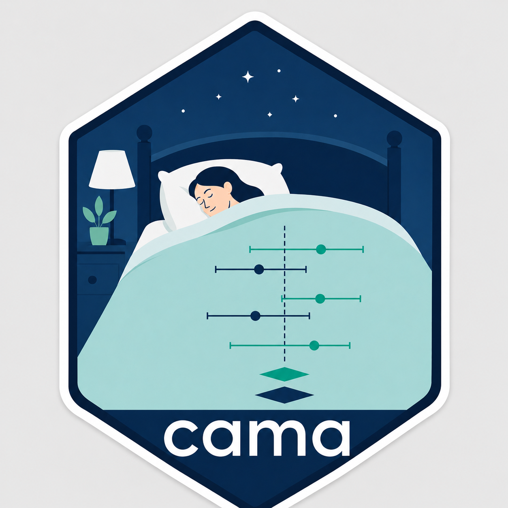

<!-- README.md is generated from README.Rmd. Please edit that file -->

```{r, include = FALSE}
knitr::opts_chunk$set(
  collapse = TRUE,
  comment = "#>",
  fig.path = "man/figures/README-",
  out.width = "100%"
)
```

# interactmeta



<!-- badges: start -->
[](https://github.com/rvpanaro/interactmeta/actions/workflows/R-CMD-check.yaml)
[](https://github.com/rvpanaro/interactmeta/actions/workflows/pkgdown.yaml)
[](https://codecov.io/gh/rvpanaro/interactmeta)
<!-- badges: end -->

**Contribution-adjusted meta-analysis (CAMS)** for treatment effect modification from
modifier-level aggregate data — [Panaro, Röver & Friede (2025)](https://arxiv.org/abs/2512.18785).

- **`cams()`** — fit CAMS from paired subgroup summaries (Bayesian default; REML/ML via `metafor`)
- **`interactions()`**, **`modifiers()`**, **`combined()`** — estimands on a fitted model
- **`forestplot()`**, **`plot()`**, **`tidy()`** — plots and export tables
- **`da()`**, **`ad()`**, **`swada()`**, **`conventional()`** — DA / AD constructions and SWADA consistency

**Docs (pkgdown):** <https://rvpanaro.github.io/interactmeta/>

| Article | What it covers |
| --- | --- |
| [Getting started with CAMS](https://rvpanaro.github.io/interactmeta/articles/cams.html) | Estimands and workflow on `age` (Bayesian) and `steroids` (REML) |
| [Heterogeneity after CAMS](https://rvpanaro.github.io/interactmeta/articles/heterogeneity-after-cams.html) | \(\tau\) / \(\tau_\gamma\), heterogeneity plots, traceplots |
| [DA, AD, and SWADA vs CAMS](https://rvpanaro.github.io/interactmeta/articles/comparing-da-ad-swada.html) | Constructions alongside the main CAMS analysis |
| [Example datasets](https://rvpanaro.github.io/interactmeta/articles/worked-examples.html) | `steroids`, `age`, RESPIRE, and related tables |

[Function reference](https://rvpanaro.github.io/interactmeta/reference/index.html) · [News](https://rvpanaro.github.io/interactmeta/news/index.html)

## Installation

``` r
# install.packages("remotes")
remotes::install_github("rvpanaro/interactmeta")
```

## Example

Steroids trials, invasive vs non-invasive ventilation as modifier (`REML` for a quick frequentist fit):

``` r
library(interactmeta)

st <- steroids[steroids$n > 0, ]
es <- escalc(
  measure = "OR",
  ai = treat.events,
  bi = treat.total - treat.events,
  ci = cont.events,
  di = cont.total - cont.events,
  data = st
)
both <- c("CAPE COVID", "COVID STEROID", "REMAP-CAP", "Steroids-SARI")
fit <- cams(es[es$study %in% both, ], reference = "Non-IMV", method = "REML")

interactions(fit, exponentiate = TRUE)
modifiers(fit, exponentiate = TRUE)
forestplot(fit, exponentiate = TRUE)
```

## Citation

``` bibtex
@article{panaro2025cams,
  title   = {Consistent Bayesian meta-analysis on subgroup specific effects and interactions},
  author  = {Panaro, Renato and R{\"o}ver, Christian and Friede, Tim},
  journal = {arXiv preprint arXiv:2512.18785},
  year    = {2025},
  doi     = {10.48550/arXiv.2512.18785}
}
```