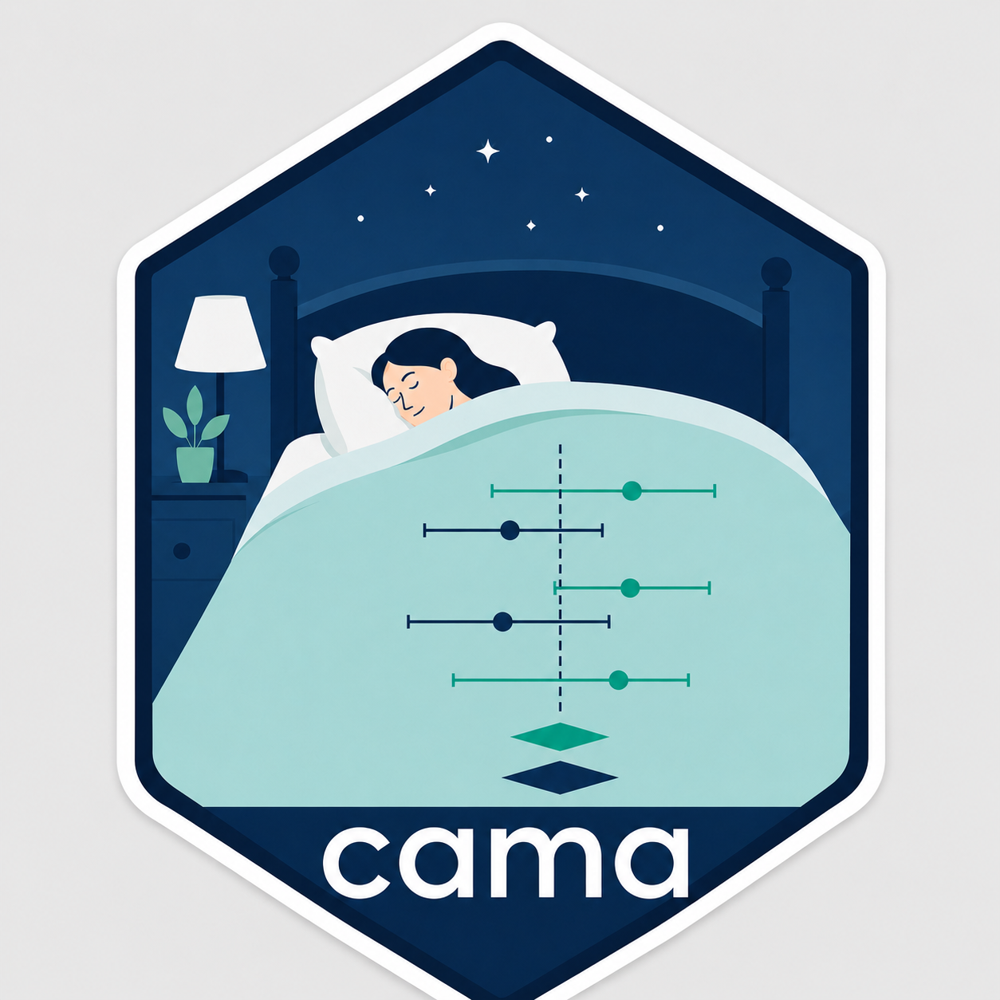

<!-- README.md is generated from README.Rmd. Please edit that file -->

# interactmeta



<!-- badges: start -->

<!-- badges: end -->

**interactmeta** implements **contribution-adjusted meta-analysis
(CAMS)** for treatment-by-subgroup interactions from
subgroup-level aggregate data (Panaro, Röver & Friede 2025):
[*Consistent Bayesian meta-analysis on subgroup specific effects and interactions*](https://arxiv.org/abs/2512.18785).

The package constructs trial information fractions π<sub>j</sub>, rotates
(y<sub>Aj</sub>, y<sub>Bj</sub>) into orthogonal overall and interaction series
(m<sub>j</sub>, g<sub>j</sub>), and reconstructs γ, μ<sub>A</sub>(π),
μ<sub>B</sub>(π), and M(π). Subgroup-specific effects are inputs and
derived outputs. The target is not a separate meta-analysis within each
subgroup.

`bayesmeta` and `metafor` fit the two blocks. interactmeta adds the CAMS
rotation, reconstruction, and contribution-adjusted estimands.
`interactions()`, `subgroups()`, and `combined()` extract those estimands
(`overall()` is an alias of `combined()`). `plot_contribution()` draws
μ<sub>A</sub>(π), μ<sub>B</sub>(π), and M(π) across π.
See `vignette("cam")`.

**DA** (`da()`, Difference of Averages) and **AD** (`ad()`, Average
Difference) are **different constructions** (Panaro, Röver & Friede
2026); they need not agree. **SWADA** (`swada()`, Same Weighting Across
Different Analyses) is a shared-weight principle for those
constructions, not a fourth model. They are context for CAMS, not
alternative CAMS models. See
`vignette("consistent-interactions")`.

## Installation

``` r
# From a local clone (this checkout has no git remote configured):
# remotes::install_local(".")
# GitHub install requires a repository URL; none is assumed here.
```

CAMS can be fitted using Bayesian or frequentist inference. These are
not two different scientific models. The approaches are bayesmeta /
DIRECT quadrature (the default) and metafor (restricted maximum
likelihood, REML, or maximum likelihood, ML). See
`vignette("engine-comparison")`.

## Example

``` r
library(interactmeta)

es <- escalc(measure = "IRR", yi = age$yi, vi = age$vi, data = age)
fit <- cam(es, reference = "Younger")
interactions(fit, exponentiate = TRUE)
subgroups(fit, exponentiate = TRUE)
plot_contribution(fit)
```

## Citation

``` bibtex
@article{panaro2025cams,
  title   = {Consistent Bayesian meta-analysis on subgroup specific effects and interactions},
  author  = {Panaro, Renato and R{\"o}ver, Christian and Friede, Tim},
  journal = {arXiv preprint arXiv:2512.18785},
  year    = {2025},
  doi     = {10.48550/arXiv.2512.18785}
}
```
